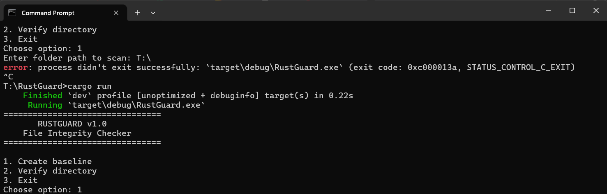
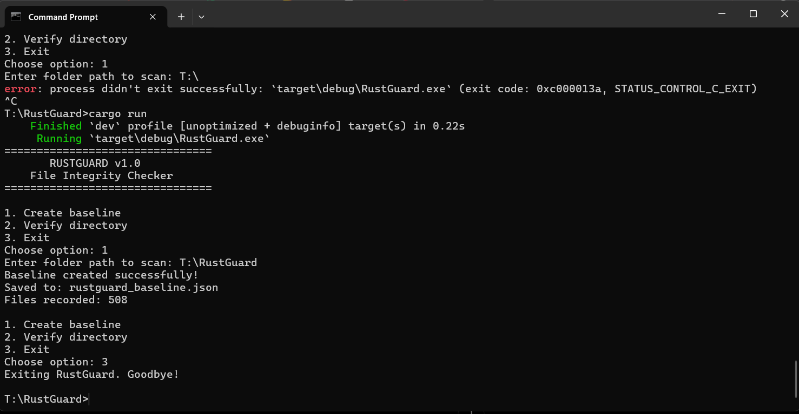
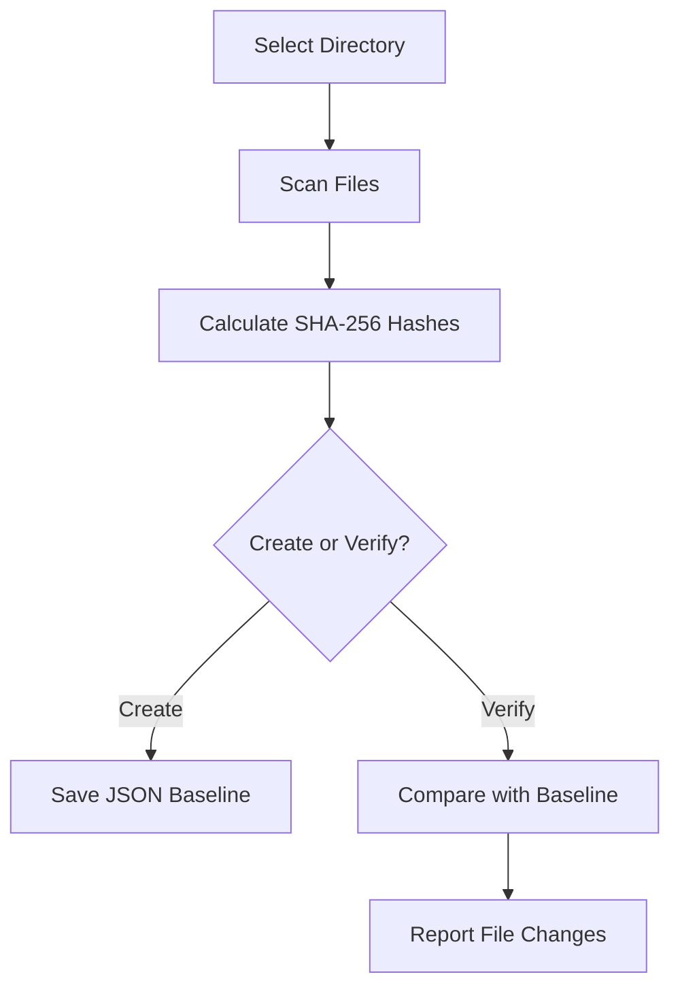

<div align="center">

# RustGuard

**Lightweight File Integrity Monitoring Powered by Rust**


[Features](#features) · [Installation](#installation) · [Usage](#usage) · [How It Works](#how-it-works) · [Limitations](#security-notes-and-limitations) · [Contributing](#contributing)

</div>

---

## Table of Contents

- [Overview](#overview)
- [Features](#features)
- [Technology Stack](#technology-stack)
- [Project Structure](#project-structure)
- [Installation](#installation)
- [Usage](#usage)
- [Output Example](#output-example)
- [Screenshots](#screenshots)
- [How It Works](#how-it-works)
- [Security Notes and Limitations](#security-notes-and-limitations)
- [Future Improvements](#future-improvements)
- [Contributing](#contributing)
- [License](#license)
- [Support the Project](#support-the-project)

---

## Overview

**RustGuard** is a command-line file integrity checker written in Rust. It calculates SHA-256 hashes of the files in a directory, saves them as a baseline in JSON format, and compares later scans against that baseline to detect **modified**, **deleted**, and **newly added** files.

It is a small, readable project that shows how file integrity monitoring works, built with Rust's safety and performance in mind.

---

## Features

| Feature | Description |
|---|---|
| SHA-256 hashing | File hashes are calculated with the `sha2` crate |
| Recursive scanning | Scans the chosen directory and all its subdirectories |
| JSON baseline | Saves file paths and hashes to a JSON file |
| Integrity verification | Compares the current state of a directory against the saved baseline |
| Change detection | Reports **modified**, **deleted**, and **new** files |
| Interactive CLI menu | Create baseline, verify directory, or exit |
| Basic error handling | Handles invalid directory paths and filesystem errors |
| Modular design | Scanning and integrity logic live in separate Rust modules |

---

## Technology Stack

| Technology | Role |
|---|---|
| **Rust** | Core programming language |
| **Cargo** | Build system and package manager |
| [`sha2`](https://crates.io/crates/sha2) | Computes SHA-256 hashes of file contents |
| [`serde`](https://crates.io/crates/serde) | Serialization and deserialization of the baseline data |
| [`serde_json`](https://crates.io/crates/serde_json) | Reads and writes the baseline in JSON format |

---

## Project Structure

```text
RustGuard/
├── Cargo.toml
├── Cargo.lock
├── README.md
├── rustguard_baseline.json   # Generated at runtime
├── assets/
│   ├── rustguard-menu.png
│   └── rustguard-demo.png
└── src/
    ├── main.rs
    ├── scanner.rs
    └── integrity.rs
```


<details>
<summary><b>Module responsibilities</b></summary>

| File | Purpose |
|---|---|
| `src/main.rs` | Entry point and command-line menu |
| `src/scanner.rs` | Directory scanning and file hashing |
| `src/integrity.rs` | Baseline handling and comparison logic |

</details>

---

## Installation

### Prerequisites

- The [Rust toolchain](https://www.rust-lang.org/tools/install) installed (via `rustup`)
- `cargo` available in your terminal

To check, open **PowerShell** or **Command Prompt** and run:

```bash
rustc --version
cargo --version
```

### Build

```bash
git clone https://github.com/yogendra-08/RustGuard.git
cd RustGuard
cargo build
```

---

## Usage

Start the program:

```bash
cargo run
```

Then follow these steps:

1. **Create a baseline:** choose option `1`.
2. **Enter the directory path** you want to monitor, for example `T:\RustGuard\src`. This is only an example, so enter the path of your own directory.
3. **Make changes** to the directory later (edit, delete, or add files).
4. **Verify the directory:** choose option `2` and enter the same directory path.
5. **Review** the per-file statuses and the summary.
6. **Exit:** choose option `3`.

---

## Output Example

> This is a **representative example**, not guaranteed real output. The statuses you see depend on the files in your directory and the changes made since the baseline was created.

```text
================================
       RUSTGUARD v1.0
    File Integrity Checker
================================

1. Create baseline
2. Verify directory
3. Exit

========== SCAN RESULTS ==========
[OK]      src/main.rs
[CHANGED] config.json
[DELETED] old_file.txt
[NEW]     notes.txt

========== SUMMARY ==========
Modified files: 1
Deleted files : 1
New files     : 1
```

| Status | Meaning |
|---|---|
| `[OK]` | File hash matches the baseline |
| `[CHANGED]` | File hash differs from the baseline |
| `[DELETED]` | File is in the baseline but no longer present |
| `[NEW]` | File exists now but was not in the baseline |

---

## Screenshots


**Main menu**



*The RustGuard command-line menu.*

**Verification results**



*A verification scan reporting file statuses and a summary.*

---

## How It Works

1. Select a directory.
2. RustGuard reads the files and calculates their SHA-256 hashes.
3. File paths and hashes are stored in a JSON baseline.
4. A later scan calculates the current hashes.
5. RustGuard compares both snapshots.
6. It reports unchanged, modified, deleted, and new files.



---

## Security Notes and Limitations

RustGuard is a **learning-oriented** integrity checker. Please be aware of the following:

- SHA-256 hashes can help detect content changes **when compared with a trusted baseline**.
- The baseline is a normal JSON file. It is **not digitally signed or tamper-proof**.
- An attacker who can modify both the files and the baseline may evade detection.
- This project is **not** a complete antivirus or enterprise security product.

<details>
<summary><b>Current technical limitations</b></summary>

- Symlinks are skipped by the current scanner.
- Each file is read fully into memory, which may be inefficient for very large files.
- There are no digital signatures, scheduled monitoring, graphical interface, or secure file wiping.

</details>

---

## Future Improvements

These are ideas only and are **not implemented yet**:

- [ ] Digitally signed baselines
- [ ] Better protection for baseline storage
- [ ] Streaming hashing for large files
- [ ] Exclusion patterns
- [ ] CSV and HTML reports
- [ ] Automated scheduled scans
- [ ] Unit and integration tests
- [ ] Cross-platform testing
- [ ] Optional GUI

---

## Contributing

Contributions are welcome!

1. **Fork** the repository.
2. **Create a branch:** `git checkout -b feature/your-feature-name`
3. **Make your changes** and test them with `cargo build` and `cargo run`.
4. **Commit:** `git commit -m "Describe your change"`
5. **Push:** `git push origin feature/your-feature-name`
6. **Open a pull request** describing what you changed and why.

Bug reports and suggestions can be submitted through GitHub Issues.

---

## License

No license has been selected for this project yet. A license should be chosen and a `LICENSE` file added before distributing or accepting outside contributions.

---

## Support the Project

If you find RustGuard useful or interesting, please consider **starring the repository** and contributing. Feedback and improvements are always appreciated.

<div align="center">

**Built with Rust**

</div>